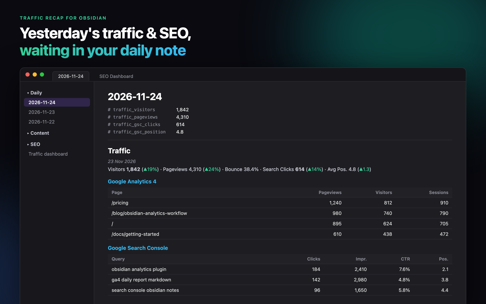
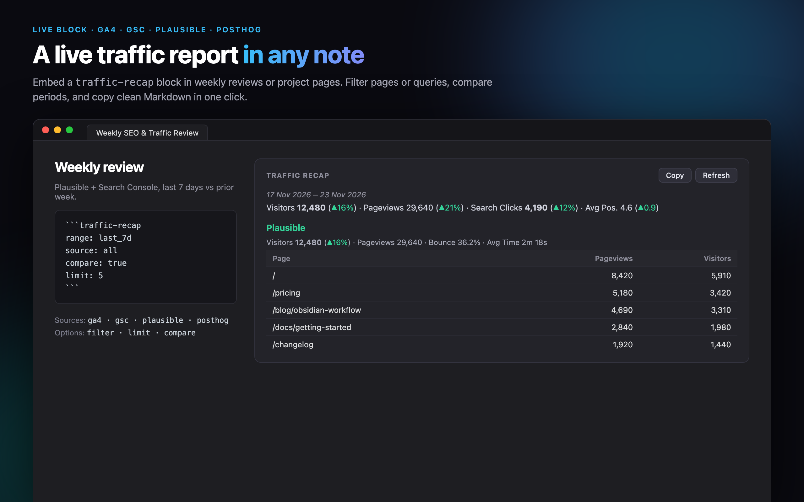

# Traffic Recap

> ⭐ If Traffic Recap saves you time, a star helps other marketers, SEOs and indie makers find it. Found a bug or have an idea? [Open an issue](https://github.com/chi-li-peppers/obsidian-traffic-recap/issues).

[](https://github.com/chi-li-peppers/obsidian-traffic-recap/releases/latest)
[](https://github.com/chi-li-peppers/obsidian-traffic-recap/actions/workflows/ci.yml)
[](LICENSE)


Your Google Analytics 4, Google Search Console, Plausible and PostHog metrics, right inside Obsidian.

Traffic Recap pulls website visitors, pageviews, top pages and Search Console queries into clean Markdown tables and daily note properties — ready to chart with Obsidian **Bases** or Dataview.



## Features

- **Google Analytics 4 (GA4)**: active users, sessions, pageviews, bounce rate, key events and top pages
- **Google Search Console (GSC)**: clicks, impressions, CTR, average position (with ▲/▼ position delta), top queries and optional lag-day offset
- **Plausible Analytics**: visitors, pageviews, bounce rate, visit duration and top pages (Cloud or self-hosted)
- **PostHog**: unique visitors, sessions, pageviews and top paths via HogQL (US, EU or self-hosted)
- **Daily note automation**: works with core Daily notes and Periodic Notes
- **Note properties**: `traffic_visitors`, `traffic_sessions`, `traffic_pageviews`, `traffic_bounce_rate`, `traffic_gsc_clicks`, `traffic_gsc_impressions`, `traffic_gsc_ctr`, `traffic_gsc_position`
- **Live block**: embed a `traffic-recap` block with Refresh, Copy, `filter` and `limit` options
- **Secret Storage**: supports Obsidian 1.11.4+ built-in Secret Storage so tokens stay out of `data.json`
- **Works on mobile** & includes **Demo mode**

## Live block



````markdown
```traffic-recap
range: last_7d
source: all
compare: true
```
````

Options:
- `range`: `today`, `yesterday`, `last_7d`, `last_14d`, `last_30d` (any `last_Nd`), `this_month`, `last_month`, `YYYY-MM-DD`, or `YYYY-MM-DD..YYYY-MM-DD`
- `source`: `all`, `ga4`, `gsc`, `plausible` or `posthog`
- `compare`: `true` or `false`
- `filter`: optional case-insensitive substring filter on page path or query
- `limit`: optional maximum rows per table

## Connecting sources

### Google Analytics 4 & Search Console
1. In Google Cloud Console, enable **Google Analytics Data API** and/or **Google Search Console API** and create a Desktop OAuth client.
2. Generate a refresh token via [OAuth 2.0 Playground](https://developers.google.com/oauthplayground) (tick *Use your own OAuth credentials*) with scopes `https://www.googleapis.com/auth/analytics.readonly` and/or `https://www.googleapis.com/auth/webmasters.readonly`.
3. Paste your GA4 numeric property ID and/or Search Console site URL (`sc-domain:example.com` or `https://example.com/`), enter OAuth credentials, and press **Test**.

### Plausible Analytics
1. Create a Stats API key in your Plausible account settings.
2. Enter your **Server URL** (`https://plausible.io` for Cloud, or your self-hosted `https://…` URL), site domain and API key, then press **Test Plausible**.

### PostHog
1. Create a Personal API key with `query:read` scope in PostHog settings.
2. Enter your Project ID, Host (`https://us.posthog.com`, `https://eu.posthog.com` or self-hosted) and API key, then press **Test PostHog**.

## Privacy

- Requests go only to `oauth2.googleapis.com`, `analyticsdata.googleapis.com`, `searchconsole.googleapis.com`, your Plausible host and your PostHog host.
- On Obsidian 1.11.4+, secrets can be stored in Obsidian's built-in **Secret Storage** outside `data.json`.

## Install

Search for **Traffic Recap** in **Settings → Community plugins**, or install manually by copying `main.js`, `manifest.json` and `styles.css` from the [latest release](../../releases/latest) to `<vault>/.obsidian/plugins/traffic-recap/` and enabling the plugin.

## More Obsidian plugins & themes

- **[Ad Recap](https://github.com/chi-li-peppers/obsidian-ad-recap)** — Google Ads & Meta Ads metrics in your notes
- **[UTM Vault](https://github.com/chi-li-peppers/obsidian-utm-vault)** — build, validate and audit UTM tracking links
- **[Bases Conditional Format](https://github.com/chi-li-peppers/obsidian-bases-conditional-format)** — colour badges, row highlights and progress bars for Obsidian Bases
- **[Chili](https://github.com/chi-li-peppers/obsidian-chili)** & **[Popcorn](https://github.com/chi-li-peppers/obsidian-popcorn)** — Obsidian themes

## License

[MIT](LICENSE) © 2026 David ([chi-li-peppers](https://github.com/chi-li-peppers))
